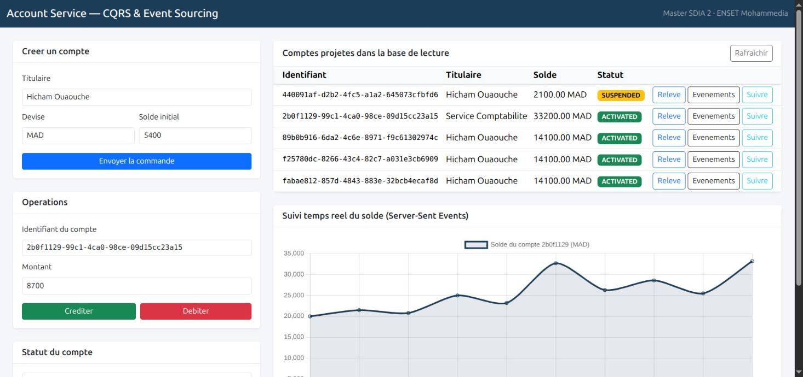
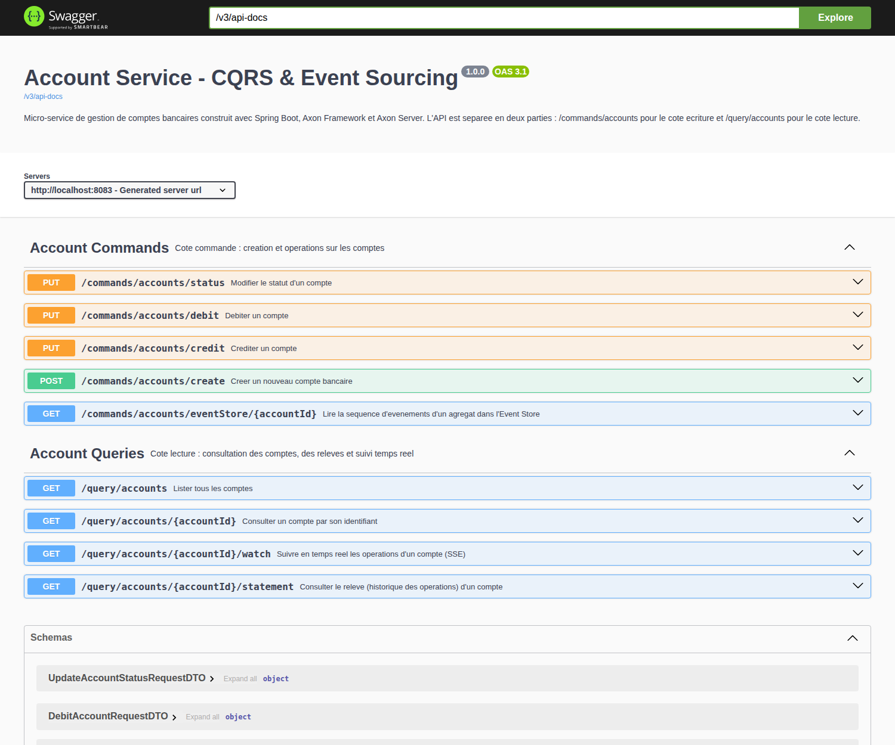
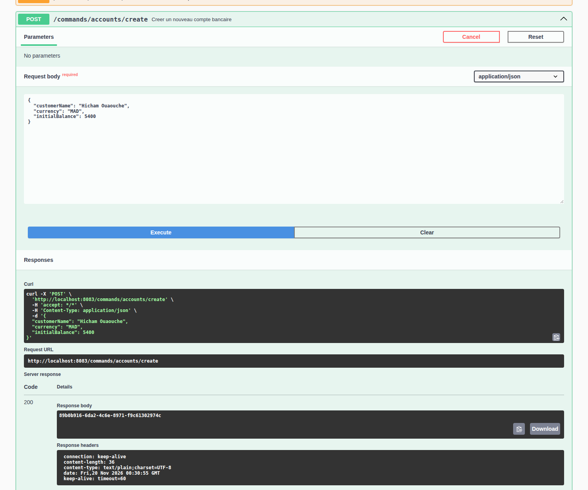
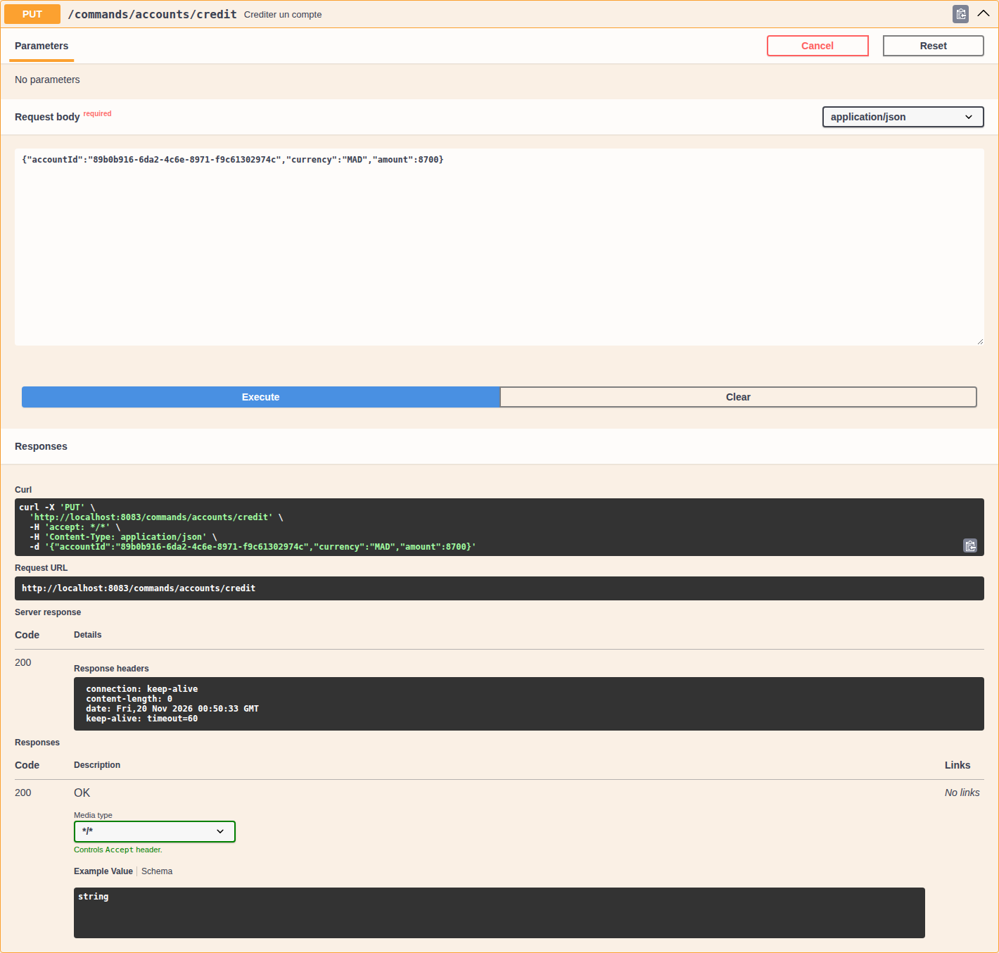
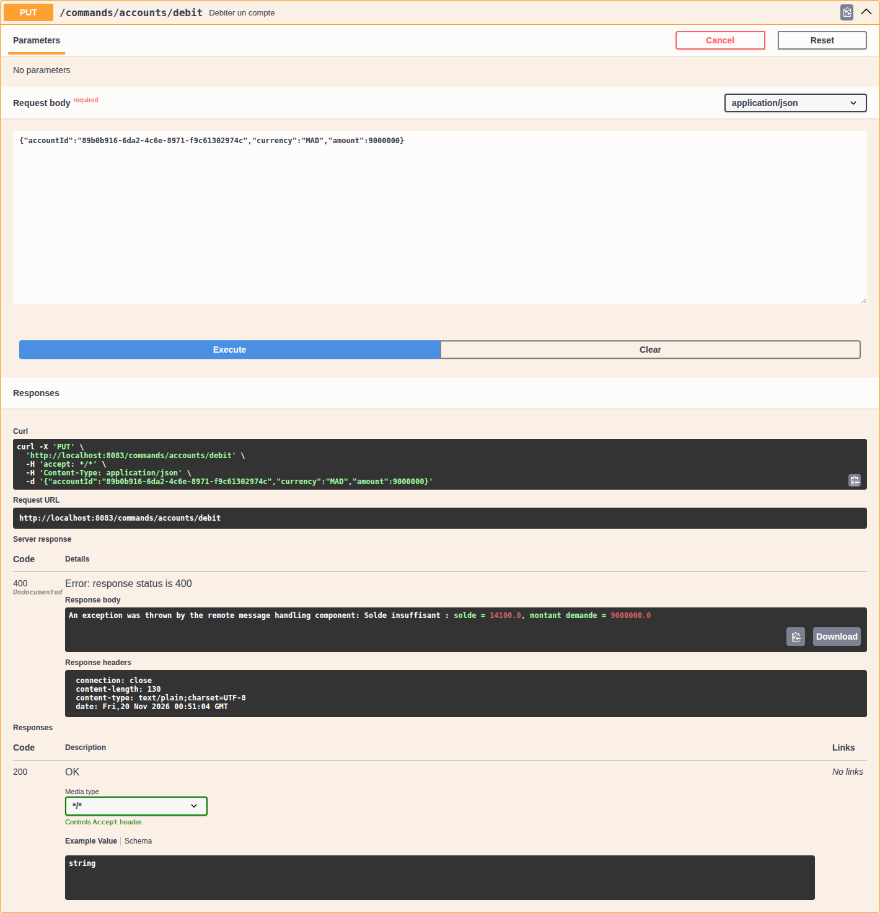
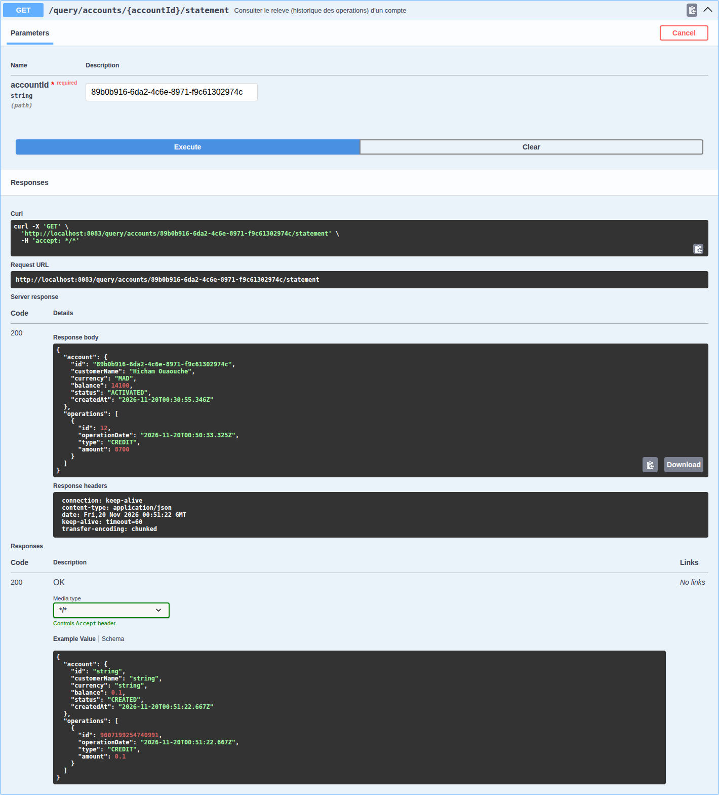
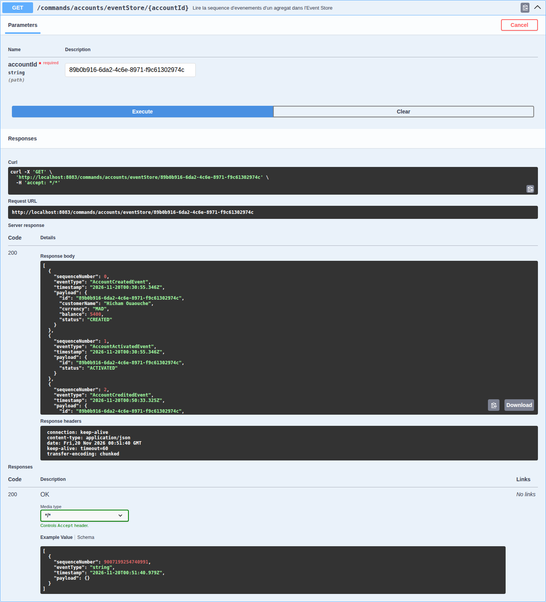
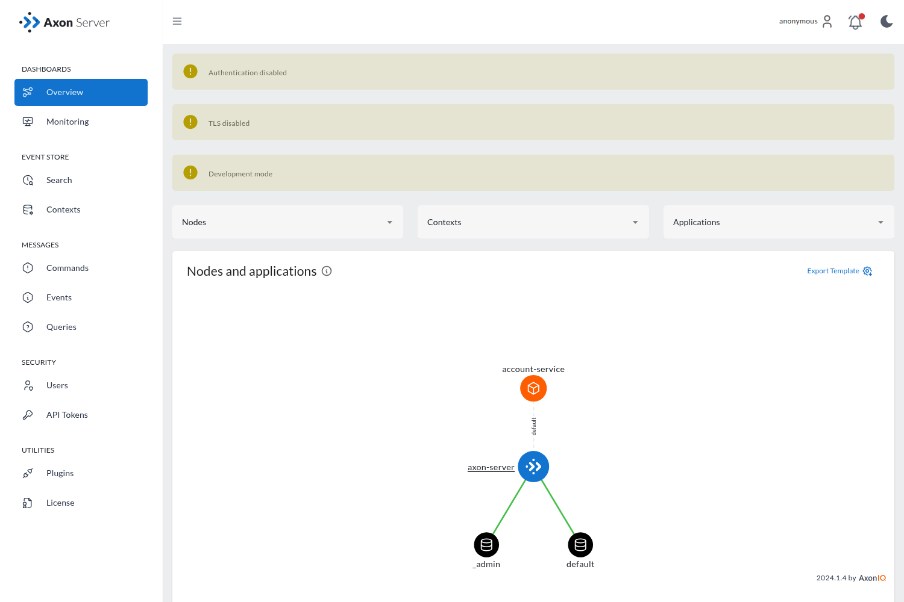
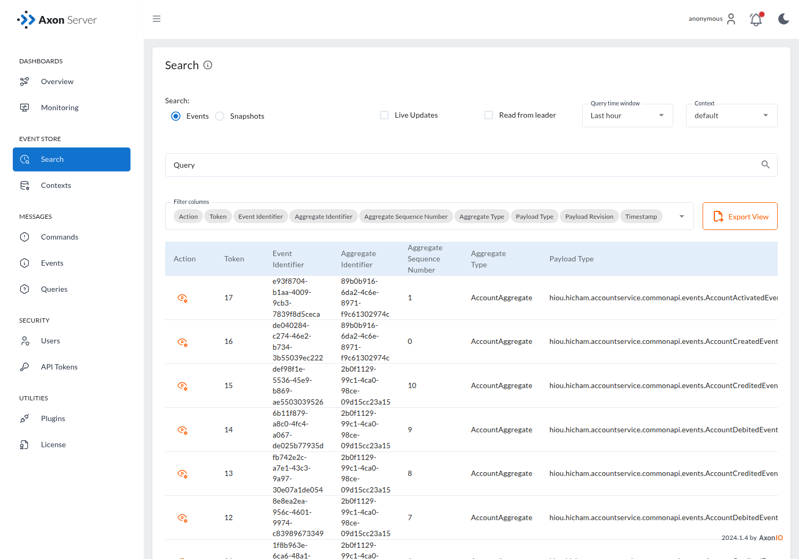
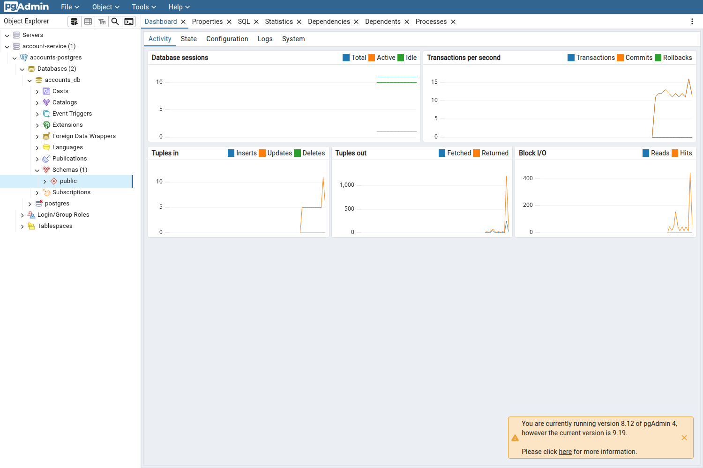

# Comptes bancaires en CQRS et Event Sourcing — Spring Boot + Axon Framework + Axon Server

Projet realise dans le cadre du module **Systemes Distribues et DevOps**, Master SDIA 2eme annee,
ENSET Mohammedia. L'objectif est de mettre en pratique les patterns **Event Sourcing** et
**CQRS** (Command Query Responsibility Segregation) sur une application de gestion de comptes
bancaires, puis de passer d'un Event Store local a un **Axon Server** communiquant en gRPC,
comme dans une architecture micro-services distribuee.

---

## Sommaire

1. [Ce que fait l'application](#1-ce-que-fait-lapplication)
2. [Les deux patterns](#2-les-deux-patterns)
3. [Architecture retenue](#3-architecture-retenue)
4. [Technologies et versions](#4-technologies-et-versions)
5. [Structure du projet](#5-structure-du-projet)
6. [Demarrage](#6-demarrage)
7. [Le cote commande](#7-le-cote-commande)
8. [Le cote lecture](#8-le-cote-lecture)
9. [Le temps reel avec les Server-Sent Events](#9-le-temps-reel-avec-les-server-sent-events)
10. [Passage a Axon Server](#10-passage-a-axon-server)
11. [API REST](#11-api-rest)
12. [Tests de A a Z](#12-tests-de-a-a-z)
13. [Problemes rencontres et solutions](#13-problemes-rencontres-et-solutions)
14. [Pistes d'evolution](#14-pistes-devolution)

---

## 1. Ce que fait l'application

L'application permet de :

- creer un compte bancaire (le compte est active automatiquement apres sa creation) ;
- crediter un compte ;
- debiter un compte, en refusant l'operation si le solde est insuffisant ;
- modifier le statut d'un compte (ACTIVATED, SUSPENDED, CLOSED) ;
- consulter la liste des comptes et le detail d'un compte ;
- consulter le releve d'un compte, c'est-a-dire l'historique de ses operations ;
- consulter la sequence brute d'evenements d'un agregat telle qu'elle est stockee dans l'Event Store ;
- suivre en temps reel les operations d'un compte dans le navigateur.

Les regles metier verifiees par l'agregat sont les suivantes :

| Regle | Exception levee |
|---|---|
| Le solde initial ne peut pas etre negatif | `NegativeAmountException` |
| Le montant d'un credit ou d'un debit doit etre strictement positif | `NegativeAmountException` |
| Le compte doit etre actif pour accepter une operation | `AccountNotActivatedException` |
| Le montant debite ne peut pas depasser le solde | `InsufficientBalanceException` |

## 2. Les deux patterns

**Event Sourcing.** On n'enregistre pas l'etat courant du compte, mais la suite des evenements
metier qui l'ont produit. Le solde n'est pas une colonne qui fait autorite : c'est le resultat de
l'agregation de la sequence `AccountCreatedEvent`, `AccountCreditedEvent`, `AccountDebitedEvent`...
Avant de traiter chaque commande, Axon relit tous les evenements de l'agregat concerne et rejoue
la fonction d'evolution pour reconstruire l'etat en memoire. On garde ainsi une base d'audit
complete, on peut rejouer l'historique pour reconstruire une projection, et on sait toujours
pourquoi le solde vaut ce qu'il vaut.

Deux fonctions cohabitent dans l'agregat :

- la **fonction de decision**, `(State, Command) => List[Event]`, portee par les `@CommandHandler` :
  elle verifie les regles metier et publie des evenements ;
- la **fonction d'evolution**, `(State, Event) => State`, portee par les `@EventSourcingHandler` :
  elle ne contient aucune regle metier, elle ne fait que muter l'etat.

**CQRS.** Le modele d'ecriture (l'agregat) et le modele de lecture (les tables `accounts` et
`account_operations`) sont separes. Les commandes passent par le Command Bus, les requetes par le
Query Bus, et les deux cotes sont relies uniquement par les evenements qui transitent sur
l'Event Bus. Les deux parties peuvent evoluer et monter en charge independamment.

## 3. Architecture retenue

```
                                  Navigateur / Swagger UI
                                            |
                 +--------------------------+--------------------------+
                 |  POST / PUT                                 GET     |
                 v                                                     v
     AccountCommandController                              AccountQueryController
                 |                                                     |
          CommandGateway                                        QueryGateway
                 |                                                     |
    =============|=====================  Axon Server  ==================|============
                 |         (gRPC, port 8124 - console web port 8024)    |
          Command Bus                  Event Bus                   Query Bus
                 |                       |     |                       |
                 v                       |     |                       v
        AccountAggregate ---> apply() ---+     +---> AccountEventHandler    AccountQueryHandler
        @CommandHandler                              @EventHandler               @QueryHandler
        @EventSourcingHandler                              |                          |
                 |                                         v                          v
                 v                                 +--------------------------------------+
           Event Store                             |      PostgreSQL (base de lecture)     |
        (gere par Axon Server)                     |   accounts  /  account_operations     |
                                                   +--------------------------------------+
                                                                   ^
                                                     QueryUpdateEmitter --> Flux SSE
```

Le point important est que le controleur de commande ne connait pas l'agregat, et que le
controleur de requete ne connait pas la base de donnees : tout passe par les bus d'Axon. C'est ce
qui permet, le jour ou l'on decoupe l'application en plusieurs micro-services, de deplacer un
handler dans un autre service sans rien changer au reste du code.

## 4. Technologies et versions

| Composant | Version | Role |
|---|---|---|
| Java | 21 | langage |
| Spring Boot | 3.5.3 | socle applicatif |
| Axon Framework | 4.11.2 | Command Bus, Query Bus, Event Bus, Event Sourcing |
| Axon Server | 2024.1.4 | Event Store distribue et dispatching des messages (gRPC) |
| PostgreSQL | 16 | base de lecture (projection) |
| pgAdmin | 8.12 | administration de la base de lecture |
| Project Reactor | fourni par Spring Boot | flux `Flux` pour le streaming SSE |
| SpringDoc OpenAPI | 2.8.6 | documentation et test des endpoints (Swagger UI) |
| Lombok | fourni par Spring Boot | reduction du code technique |
| Maven | 3.9 | build multi-modules |

## 5. Structure du projet

```
axon-cqrs-microservices/
├── pom.xml                        # pom parent (multi-modules)
├── docker-compose.yml             # Axon Server + PostgreSQL + pgAdmin
├── docker/pgadmin/servers.json    # connexion pgAdmin pre-enregistree
├── requests/                      # requetes HTTP pretes a rejouer
│   ├── commands.http
│   └── queries.http
├── docs/screenshots/              # captures des tests
└── account-service/
    ├── Dockerfile
    ├── pom.xml
    └── src
        ├── main/java/hiou/hicham/accountservice/
        │   ├── AccountServiceApplication.java
        │   ├── config/OpenApiConfig.java
        │   ├── commonapi/                      # contrat partage (API commune)
        │   │   ├── commands/                   # AddAccountCommand, CreditAccountCommand, ...
        │   │   ├── events/                     # AccountCreatedEvent, AccountCreditedEvent, ...
        │   │   ├── queries/                    # GetAllAccountsQuery, GetAccountStatementQuery, ...
        │   │   ├── dtos/                       # DTO d'entree et de sortie
        │   │   └── enums/                      # AccountStatus, OperationType
        │   ├── commands/                       # cote ecriture
        │   │   ├── aggregates/AccountAggregate.java
        │   │   ├── controllers/AccountCommandController.java
        │   │   └── exceptions/
        │   └── query/                          # cote lecture
        │       ├── entities/                   # Account, AccountOperation
        │       ├── repositories/               # AccountRepository, AccountOperationRepository
        │       ├── services/                   # AccountEventHandler, AccountQueryHandler
        │       ├── mappers/AccountMapper.java
        │       └── controllers/AccountQueryController.java
        ├── main/resources/
        │   ├── application.properties
        │   └── static/index.html               # interface de test (tableau de bord)
        └── test/java/hiou/hicham/accountservice/
            ├── commands/AccountAggregateTest.java
            ├── query/AccountEventHandlerTest.java
            ├── query/AccountQueryHandlerTest.java
            └── integration/AccountFlowIntegrationTest.java
```

Le package `commonapi` regroupe commandes, evenements, requetes et DTO. C'est volontaire : lorsque
l'application sera decoupee en plusieurs micro-services (par exemple un `analytics-service`), ce
package deviendra une bibliotheque commune partagee par les services.

## 6. Demarrage

### Prerequis

- JDK 21
- Maven 3.9
- Docker et Docker Compose

### Lancer l'infrastructure

```bash
docker compose up -d
```

Trois conteneurs demarrent :

| Service | URL | Identifiants |
|---|---|---|
| Axon Server | http://localhost:8024 (console), `localhost:8124` (gRPC) | aucun |
| PostgreSQL | `localhost:5432`, base `accounts_db` | `postgres` / `postgres` |
| pgAdmin | http://localhost:8888 | connexion `accounts-postgres` deja enregistree, mot de passe `postgres` |

### Compiler et lancer le micro-service

```bash
mvn clean package
java -jar account-service/target/account-service-1.0.0.jar
```

Le service ecoute sur le port **8083** :

- interface de test : http://localhost:8083/
- Swagger UI : http://localhost:8083/swagger-ui.html

## 7. Le cote commande

Les commandes heritent d'une classe de base qui porte l'identifiant de l'agregat cible. C'est
l'annotation `@TargetAggregateIdentifier` qui indique au Command Bus vers quelle instance
d'agregat router la commande.

```java
public abstract class BaseCommand<T> {
    @TargetAggregateIdentifier
    @Getter
    private final T id;

    protected BaseCommand(T id) {
        this.id = id;
    }
}
```

Le controleur ne fait que transformer la requete HTTP en commande et la deposer sur le bus :

```java
@PostMapping("/create")
public CompletableFuture<String> createAccount(@RequestBody @Valid CreateAccountRequestDTO request) {
    return commandGateway.send(new AddAccountCommand(
            UUID.randomUUID().toString(),
            request.getCustomerName(),
            request.getCurrency(),
            request.getInitialBalance()
    ));
}
```

Toute la logique metier se trouve dans l'agregat. Un detail interessant : l'activation du compte
n'est pas decidee par le controleur mais par l'agregat lui-meme, depuis la fonction d'evolution de
`AccountCreatedEvent`. C'est le cas ou le systeme decide d'agir sur lui-meme, et cela donne bien
deux evenements distincts dans l'Event Store.

```java
@CommandHandler
public AccountAggregate(AddAccountCommand command) {
    if (command.getInitialBalance() < 0) {
        throw new NegativeAmountException("Le solde initial ne peut pas etre negatif");
    }
    AggregateLifecycle.apply(new AccountCreatedEvent(
            command.getId(), command.getCustomerName(),
            command.getCurrency(), command.getInitialBalance(), AccountStatus.CREATED));
}

@EventSourcingHandler
public void on(AccountCreatedEvent event) {
    this.accountId = event.getId();
    this.balance = event.getBalance();
    this.status = event.getStatus();
    AggregateLifecycle.apply(new AccountActivatedEvent(event.getId(), AccountStatus.ACTIVATED));
}

@CommandHandler
public void handle(DebitAccountCommand command) {
    if (command.getAmount() <= 0) {
        throw new NegativeAmountException("Le montant du debit doit etre strictement positif");
    }
    assertAccountIsActivated();
    if (command.getAmount() > this.balance) {
        throw new InsufficientBalanceException(
                "Solde insuffisant : solde = " + this.balance + ", montant demande = " + command.getAmount());
    }
    AggregateLifecycle.apply(new AccountDebitedEvent(
            command.getId(), command.getCurrency(), command.getAmount()));
}
```

Le champ `balance` teste dans `handle(DebitAccountCommand)` n'est jamais lu depuis une base : il a
ete reconstruit juste avant, en rejouant toute la sequence d'evenements de l'agregat.

## 8. Le cote lecture

Les evenements sont projetes dans deux tables relationnelles par un service annote
`@EventHandler`. C'est le seul endroit de l'application qui ecrit dans la base de lecture.

```java
@EventHandler
public void on(AccountCreditedEvent event, EventMessage<AccountCreditedEvent> message) {
    Account account = accountRepository.findById(event.getId()).orElseThrow(...);
    AccountOperation operation = AccountOperation.builder()
            .account(account)
            .amount(event.getAmount())
            .type(OperationType.CREDIT)
            .operationDate(message.getTimestamp())
            .build();
    accountOperationRepository.save(operation);
    account.setBalance(account.getBalance() + event.getAmount());
    accountRepository.save(account);
    emitWatchEvent(account, operation);
}
```

Les consultations passent par des `@QueryHandler` qui lisent uniquement cette projection, jamais
l'Event Store, et renvoient des DTO :

```java
@QueryHandler
public AccountStatementDTO on(GetAccountStatementQuery query) {
    Account account = findAccount(query.accountId());
    List<AccountOperation> operations =
            accountOperationRepository.findByAccountIdOrderByOperationDateAsc(query.accountId());
    return new AccountStatementDTO(
            accountMapper.toAccountDTO(account),
            accountMapper.toOperationDTOList(operations));
}
```

## 9. Le temps reel avec les Server-Sent Events

Le suivi temps reel repose sur une **subscription query**. Le controleur ouvre un flux
`text/event-stream` : le premier element est le resultat initial renvoye par le Query Handler, les
suivants sont les mises a jour emises par le `QueryUpdateEmitter` depuis la projection.

```java
@GetMapping(value = "/{accountId}/watch", produces = MediaType.TEXT_EVENT_STREAM_VALUE)
public Flux<AccountWatchEventDTO> watchAccount(@PathVariable String accountId) {
    SubscriptionQueryResult<AccountWatchEventDTO, AccountWatchEventDTO> result =
            queryGateway.subscriptionQuery(
                    new WatchAccountQuery(accountId),
                    ResponseTypes.instanceOf(AccountWatchEventDTO.class),
                    ResponseTypes.instanceOf(AccountWatchEventDTO.class));
    return result.initialResult()
            .concatWith(result.updates())
            .doFinally(signal -> result.close());
}
```

Cote projection, chaque credit ou debit pousse un message vers les abonnes dont la requete porte
sur le compte concerne :

```java
queryUpdateEmitter.emit(
        WatchAccountQuery.class,
        query -> query.accountId().equals(account.getId()),
        watchEvent);
```

## 10. Passage a Axon Server

Le TP commence avec un Event Store local (JPA) puis bascule sur Axon Server. Plutot que de
commenter et decommenter l'exclusion `axon-server-connector` dans le `pom.xml`, le choix se fait
ici par configuration, ce qui permet de basculer sans recompiler :

```properties
# Event Store et bus geres par Axon Server (gRPC)
axon.axonserver.enabled=true
axon.axonserver.servers=${AXON_SERVER:localhost:8124}

# Serialisation du payload des evenements en JSON
axon.serializer.events=jackson
axon.serializer.messages=jackson
axon.serializer.general=jackson
```

Avec `axon.axonserver.enabled=false`, Axon retombe sur l'Event Store JPA et les bus locaux : c'est
exactement la configuration utilisee par les tests automatises. Avec `true`, les commandes, les
requetes et les evenements transitent par Axon Server, visible dans sa console web.

Extrait du demarrage du service connecte a Axon Server :

```
INFO [main] i.a.a.c.impl.AxonServerManagedChannel : Requesting connection details from localhost:8124
INFO [main] i.a.a.c.impl.AxonServerManagedChannel : Successfully connected to localhost:8124
INFO [main] i.a.a.connector.impl.ControlChannelImpl : Connected instruction stream for context 'default'. Sending client identification
INFO [main] o.s.b.w.embedded.tomcat.TomcatWebServer : Tomcat started on port 8083 (http) with context path '/'
INFO [main] h.h.a.AccountServiceApplication : Started AccountServiceApplication in 13.992 seconds
```

## 11. API REST

### Cote commande — `/commands/accounts`

| Methode | Chemin | Description | Corps |
|---|---|---|---|
| POST | `/create` | creer un compte | `{ "customerName", "currency", "initialBalance" }` |
| PUT | `/credit` | crediter un compte | `{ "accountId", "currency", "amount" }` |
| PUT | `/debit` | debiter un compte | `{ "accountId", "currency", "amount" }` |
| PUT | `/status` | changer le statut | `{ "accountId", "status" }` |
| GET | `/eventStore/{accountId}` | sequence d'evenements de l'agregat | — |

### Cote lecture — `/query/accounts`

| Methode | Chemin | Description |
|---|---|---|
| GET | `/` | liste des comptes |
| GET | `/{accountId}` | detail d'un compte |
| GET | `/{accountId}/statement` | releve des operations |
| GET | `/{accountId}/watch` | flux SSE des operations en temps reel |

---

## 12. Tests de A a Z

Cette section reprend l'integralite des tests effectues, dans l'ordre, avec les sorties reelles
obtenues.

### A. Tests automatises

25 tests couvrent l'agregat, la projection, les Query Handlers et la chaine complete.

```bash
mvn clean test
```

```
[INFO] Running hiou.hicham.accountservice.query.AccountEventHandlerTest
[INFO] Tests run: 4, Failures: 0, Errors: 0, Skipped: 0, Time elapsed: 1.509 s
[INFO] Running hiou.hicham.accountservice.query.AccountQueryHandlerTest
[INFO] Tests run: 5, Failures: 0, Errors: 0, Skipped: 0, Time elapsed: 4.407 s
[INFO] Running hiou.hicham.accountservice.commands.AccountAggregateTest
[INFO] Tests run: 10, Failures: 0, Errors: 0, Skipped: 0, Time elapsed: 0.331 s
[INFO] Running hiou.hicham.accountservice.integration.AccountFlowIntegrationTest
[INFO] Tests run: 6, Failures: 0, Errors: 0, Skipped: 0, Time elapsed: 3.769 s
[INFO] Results:
[INFO] Tests run: 25, Failures: 0, Errors: 0, Skipped: 0
[INFO] BUILD SUCCESS
[INFO] Total time:  13.891 s
```

Le detail des quatre classes :

| Classe | Ce qui est verifie |
|---|---|
| `AccountAggregateTest` | les regles metier, avec le fixture d'Axon (Given evenements / When commande / Then evenements ou exception) |
| `AccountEventHandlerTest` | la projection de chaque evenement et l'emission vers les abonnes SSE |
| `AccountQueryHandlerTest` | les Query Handlers sur une base H2 reelle |
| `AccountFlowIntegrationTest` | la chaine complete commande -> Event Store -> projection -> requete |

Le test d'agregat est ecrit exactement comme on raisonne en Event Sourcing : on donne les
evenements deja survenus, on envoie une commande, on verifie ce qui sort.

```java
@Test
@DisplayName("Le solde reconstruit ne permet pas de depasser 24 800 MAD")
void shouldRejectDebitAboveRebuiltBalance() {
    fixture.given(
                    new AccountCreatedEvent(ACCOUNT_ID, "Hicham Ouaouche", "MAD", 8000, AccountStatus.CREATED),
                    new AccountActivatedEvent(ACCOUNT_ID, AccountStatus.ACTIVATED),
                    new AccountDebitedEvent(ACCOUNT_ID, "MAD", 1200),
                    new AccountCreditedEvent(ACCOUNT_ID, "MAD", 6000),
                    new AccountCreditedEvent(ACCOUNT_ID, "MAD", 12000))
            .when(new DebitAccountCommand(ACCOUNT_ID, "MAD", 24801))
            .expectException(InsufficientBalanceException.class);
}
```

Le test d'integration verifie aussi l'ordre exact des evenements ecrits dans l'Event Store :

```java
assertThat(eventTypes).containsExactly(
        "AccountCreatedEvent",
        "AccountActivatedEvent",
        "AccountDebitedEvent",
        "AccountCreditedEvent");
```

### B. Demarrage de l'infrastructure

```bash
docker compose up -d
docker compose ps
```

```
NAME                STATUS                    PORTS
accounts-pgadmin    Up 4 minutes              443/tcp, 0.0.0.0:8888->80/tcp
accounts-postgres   Up 29 minutes (healthy)   0.0.0.0:5432->5432/tcp
axon-server         Up 29 minutes (healthy)   0.0.0.0:8024->8024/tcp, 0.0.0.0:8124->8124/tcp
```

### C. Creation d'un compte

```bash
curl -X POST http://localhost:8083/commands/accounts/create \
  -H 'Content-Type: application/json' \
  -d '{"customerName":"Hicham Ouaouche","currency":"MAD","initialBalance":5400}'
```

```
440091af-d2b2-4fc5-a1a2-645073cfbfd6
```

La commande renvoie l'identifiant de l'agregat cree.

### D. Credit puis debit

```bash
curl -i -X PUT http://localhost:8083/commands/accounts/credit \
  -H 'Content-Type: application/json' \
  -d '{"accountId":"440091af-d2b2-4fc5-a1a2-645073cfbfd6","currency":"MAD","amount":8700}'
```

```
HTTP/1.1 200
```

```bash
curl -i -X PUT http://localhost:8083/commands/accounts/debit \
  -H 'Content-Type: application/json' \
  -d '{"accountId":"440091af-d2b2-4fc5-a1a2-645073cfbfd6","currency":"MAD","amount":12000}'
```

```
HTTP/1.1 200
```

Le solde passe donc de 5400 a 5400 + 8700 - 12000 = **2100 MAD**.

### E. Debit refuse pour solde insuffisant

```bash
curl -i -X PUT http://localhost:8083/commands/accounts/debit \
  -H 'Content-Type: application/json' \
  -d '{"accountId":"440091af-d2b2-4fc5-a1a2-645073cfbfd6","currency":"MAD","amount":9000000}'
```

```
HTTP/1.1 400
An exception was thrown by the remote message handling component:
Solde insuffisant : solde = 2100.0, montant demande = 9000000.0
```

Le message montre le solde reconstruit par l'agregat au moment du traitement de la commande, et
non une valeur lue en base.

### F. Operation refusee sur un compte suspendu

```bash
curl -i -X PUT http://localhost:8083/commands/accounts/status \
  -H 'Content-Type: application/json' \
  -d '{"accountId":"440091af-d2b2-4fc5-a1a2-645073cfbfd6","status":"SUSPENDED"}'
```

```
HTTP/1.1 200
```

```bash
curl -i -X PUT http://localhost:8083/commands/accounts/credit \
  -H 'Content-Type: application/json' \
  -d '{"accountId":"440091af-d2b2-4fc5-a1a2-645073cfbfd6","currency":"MAD","amount":500}'
```

```
HTTP/1.1 400
An exception was thrown by the remote message handling component:
Le compte 440091af-d2b2-4fc5-a1a2-645073cfbfd6 n'est pas actif (statut = SUSPENDED)
```

### G. Validation des donnees d'entree

```bash
curl -i -X POST http://localhost:8083/commands/accounts/create \
  -H 'Content-Type: application/json' \
  -d '{"customerName":"Test","currency":"MAD","initialBalance":-100}'
```

```
HTTP/1.1 400
```

La requete est rejetee par la validation Bean Validation avant meme d'atteindre le Command Bus.
La meme regle est doublee dans l'agregat (`NegativeAmountException`), car l'agregat doit proteger
ses invariants quelle que soit la provenance de la commande.

### H. Liste des comptes

```bash
curl http://localhost:8083/query/accounts
```

```json
[
    {
        "id": "440091af-d2b2-4fc5-a1a2-645073cfbfd6",
        "customerName": "Hicham Ouaouche",
        "currency": "MAD",
        "balance": 2100.0,
        "status": "ACTIVATED",
        "createdAt": "2026-11-20T00:30:16.466Z"
    },
    {
        "id": "2b0f1129-99c1-4ca0-98ce-09d15cc23a15",
        "customerName": "Service Comptabilite",
        "currency": "MAD",
        "balance": 20000.0,
        "status": "CREATED",
        "createdAt": "2026-11-20T00:30:17.147Z"
    }
]
```

Le second compte apparait encore au statut `CREATED` alors qu'il est deja active cote ecriture :
la projection n'avait pas encore traite `AccountActivatedEvent` au moment de la requete. C'est la
**consistance a terme** propre a CQRS, et c'est le comportement attendu : la base de lecture
rattrape l'etat quelques millisecondes plus tard.

### I. Releve d'un compte

```bash
curl http://localhost:8083/query/accounts/440091af-d2b2-4fc5-a1a2-645073cfbfd6/statement
```

```json
{
    "account": {
        "id": "440091af-d2b2-4fc5-a1a2-645073cfbfd6",
        "customerName": "Hicham Ouaouche",
        "currency": "MAD",
        "balance": 2100.0,
        "status": "ACTIVATED",
        "createdAt": "2026-11-20T00:30:16.466Z"
    },
    "operations": [
        {
            "id": 1,
            "operationDate": "2026-11-20T00:30:16.806Z",
            "type": "CREDIT",
            "amount": 8700.0
        },
        {
            "id": 2,
            "operationDate": "2026-11-20T00:30:16.979Z",
            "type": "DEBIT",
            "amount": 12000.0
        }
    ]
}
```

### J. Sequence d'evenements dans l'Event Store

```bash
curl http://localhost:8083/commands/accounts/eventStore/440091af-d2b2-4fc5-a1a2-645073cfbfd6
```

```json
[
    {
        "sequenceNumber": 0,
        "eventType": "AccountCreatedEvent",
        "timestamp": "2026-11-20T00:30:16.466Z",
        "payload": {
            "id": "440091af-d2b2-4fc5-a1a2-645073cfbfd6",
            "customerName": "Hicham Ouaouche",
            "currency": "MAD",
            "balance": 5400.0,
            "status": "CREATED"
        }
    },
    {
        "sequenceNumber": 1,
        "eventType": "AccountActivatedEvent",
        "timestamp": "2026-11-20T00:30:16.470Z",
        "payload": {
            "id": "440091af-d2b2-4fc5-a1a2-645073cfbfd6",
            "status": "ACTIVATED"
        }
    },
    {
        "sequenceNumber": 2,
        "eventType": "AccountCreditedEvent",
        "timestamp": "2026-11-20T00:30:16.806Z",
        "payload": {
            "id": "440091af-d2b2-4fc5-a1a2-645073cfbfd6",
            "currency": "MAD",
            "amount": 8700.0
        }
    },
    {
        "sequenceNumber": 3,
        "eventType": "AccountDebitedEvent",
        "timestamp": "2026-11-20T00:30:16.979Z",
        "payload": {
            "id": "440091af-d2b2-4fc5-a1a2-645073cfbfd6",
            "currency": "MAD",
            "amount": 12000.0
        }
    }
]
```

C'est le coeur de l'Event Sourcing : le solde de 2100 MAD n'est stocke nulle part dans cette
liste, il se deduit de 5400 + 8700 - 12000. Le debit refuse a l'etape E n'a laisse aucune trace,
puisque la fonction de decision n'a produit aucun evenement.

### K. Suivi temps reel (SSE)

Dans un premier terminal :

```bash
curl -N -H 'Accept: text/event-stream' \
  http://localhost:8083/query/accounts/2b0f1129-99c1-4ca0-98ce-09d15cc23a15/watch
```

Dans un second terminal, un credit de 1500 puis un debit de 700. Le flux recoit :

```
data:{"instant":"2026-11-20T00:30:17.147Z","accountId":"2b0f1129-99c1-4ca0-98ce-09d15cc23a15","currentBalance":20000.0,"type":null,"operationAmount":0.0}

data:{"instant":"2026-11-20T00:30:19.874Z","accountId":"2b0f1129-99c1-4ca0-98ce-09d15cc23a15","currentBalance":21500.0,"type":"CREDIT","operationAmount":1500.0}

data:{"instant":"2026-11-20T00:30:20.929Z","accountId":"2b0f1129-99c1-4ca0-98ce-09d15cc23a15","currentBalance":20800.0,"type":"DEBIT","operationAmount":700.0}
```

Le premier message est le resultat initial de la subscription query (aucune operation encore, donc
`type` est nul), les deux suivants sont pousses par le `QueryUpdateEmitter`.

### L. Interface web de test

L'interface servie sur http://localhost:8083/ permet d'envoyer les commandes, de lister les
comptes projetes et de suivre un compte en temps reel. La courbe est d'abord reconstruite a partir
du releve, puis completee en direct par les messages SSE.



### M. Swagger UI

Tous les endpoints sont documentes et testables depuis http://localhost:8083/swagger-ui.html.



J'ai repris le scenario complet directement depuis Swagger, sur un seul et meme compte, pour
verifier le cote commande et le cote lecture bout en bout.

**1. Creation du compte.** La commande renvoie l'identifiant de l'agregat
`89b0b916-6da2-4c6e-8971-f9c61302974c`, qui sert pour toutes les etapes suivantes.



**2. Credit de 8700 MAD.** Reponse HTTP 200 : la commande a ete acceptee par l'agregat et
l'evenement a ete ecrit dans l'Event Store.



**3. Debit de 9 000 000 MAD.** Reponse HTTP 400 avec le message
`Solde insuffisant : solde = 14100.0, montant demande = 9000000.0`. Le solde de 14 100 affiche
dans l'erreur est celui que l'agregat vient de reconstruire a partir de ses evenements
(5400 a la creation + 8700 de credit), ce qui prouve que la regle metier s'appuie bien sur
l'etat rejoue et non sur une valeur lue en base.



**4. Releve du compte.** Le cote lecture renvoie le solde de 14 100 MAD et l'unique operation
projetee : le debit refuse n'a laisse aucune trace, puisqu'aucun evenement n'a ete produit.



**5. Sequence d'evenements de l'agregat.** Les trois evenements stockes apparaissent dans
l'ordre, avec leur numero de sequence : `AccountCreatedEvent` (0), `AccountActivatedEvent` (1)
et `AccountCreditedEvent` (2).



### N. Console Axon Server

La console montre le micro-service `account-service` connecte au noeud `axon-server` sur le
contexte `default`.



La recherche dans l'Event Store affiche les evenements stockes, avec leur numero de sequence, le
type d'agregat `AccountAggregate` et le type du payload.



### O. Base de lecture PostgreSQL

Les tables creees dans `accounts_db` :

```
                  List of relations
 Schema |          Name           | Type  |  Owner
--------+-------------------------+-------+----------
 public | account_operations      | table | postgres
 public | accounts                | table | postgres
 public | association_value_entry | table | postgres
 public | dead_letter_entry       | table | postgres
 public | saga_entry              | table | postgres
 public | token_entry             | table | postgres
```

`accounts` et `account_operations` sont la projection ; les autres tables sont creees par Axon
(`token_entry` memorise la position de lecture du processeur d'evenements, ce qui permet de
reprendre la projection la ou elle s'etait arretee).

```sql
select id, customer_name, currency, balance, status from accounts order by created_at;
```

```
                  id                  |    customer_name     | currency | balance |  status
--------------------------------------+----------------------+----------+---------+-----------
 440091af-d2b2-4fc5-a1a2-645073cfbfd6 | Hicham Ouaouche      | MAD      |    2100 | SUSPENDED
 2b0f1129-99c1-4ca0-98ce-09d15cc23a15 | Service Comptabilite | MAD      |   33200 | ACTIVATED
 89b0b916-6da2-4c6e-8971-f9c61302974c | Hicham Ouaouche      | MAD      |    5400 | ACTIVATED
```

```sql
select id, account_id, type, amount, operation_date from account_operations order by id limit 6;
```

```
 id |              account_id              |  type  | amount |       operation_date
----+--------------------------------------+--------+--------+----------------------------
  1 | 440091af-d2b2-4fc5-a1a2-645073cfbfd6 | CREDIT |   8700 | 2026-11-20 00:30:16.806+00
  2 | 440091af-d2b2-4fc5-a1a2-645073cfbfd6 | DEBIT  |  12000 | 2026-11-20 00:30:16.979+00
  3 | 2b0f1129-99c1-4ca0-98ce-09d15cc23a15 | CREDIT |   1500 | 2026-11-20 00:30:19.874+00
  4 | 2b0f1129-99c1-4ca0-98ce-09d15cc23a15 | DEBIT  |    700 | 2026-11-20 00:30:20.929+00
  5 | 2b0f1129-99c1-4ca0-98ce-09d15cc23a15 | CREDIT |   4200 | 2026-11-20 00:30:34.076+00
  6 | 2b0f1129-99c1-4ca0-98ce-09d15cc23a15 | DEBIT  |   1800 | 2026-11-20 00:30:34.138+00
```

### P. pgAdmin

La connexion a la base de lecture est deja enregistree dans pgAdmin au demarrage du conteneur
(fichier `docker/pgadmin/servers.json`). Le mot de passe demande a la premiere connexion est
`postgres`.



### Q. Resume des tests

| # | Test | Resultat attendu | Resultat obtenu |
|---|---|---|---|
| 1 | 25 tests automatises | tous verts | 25 / 25 |
| 2 | Creation d'un compte | identifiant d'agregat renvoye | OK |
| 3 | Credit de 8700 | HTTP 200, solde 14100 | OK |
| 4 | Debit de 12000 | HTTP 200, solde 2100 | OK |
| 5 | Debit de 9000000 | HTTP 400, solde inchange | OK |
| 6 | Credit sur compte suspendu | HTTP 400 | OK |
| 7 | Solde initial negatif | HTTP 400 | OK |
| 8 | Liste des comptes | projection a jour | OK |
| 9 | Releve d'un compte | 2 operations ordonnees | OK |
| 10 | Event Store de l'agregat | 4 evenements en sequence | OK |
| 11 | Flux SSE | 1 resultat initial + 2 mises a jour | OK |
| 12 | Tables PostgreSQL | projection et tables Axon creees | OK |
| 13 | Console Axon Server | service connecte, evenements visibles | OK |
| 14 | Scenario complet depuis Swagger UI | creation, credit, debit refuse, releve, Event Store | OK |

---

## 13. Problemes rencontres et solutions

**Deserialisation d'une liste renvoyee par le Query Bus.** Avec le serialiseur Jackson et Axon
Server, une reponse envoyee avec `ResponseTypes.multipleInstancesOf(AccountResponseDTO.class)`
revenait sous la forme d'une `ArrayList` de `LinkedHashMap`, avec l'erreur
`Retrieved response [class java.util.ArrayList] is not convertible to a List of the expected
response type`. Le type des elements est perdu a la serialisation. J'ai d'abord essaye de passer
les messages en XStream comme dans le support de cours, mais XStream ne sait pas serialiser les
`record` Java (`can't get field offset on a record class`). La solution retenue est de transporter
la liste dans un type dedie `AccountListDTO`, dont les generiques sont connus a la
deserialisation, et de deballer la liste dans le controleur pour que l'API REST continue
d'exposer un simple tableau JSON.

**Deserialisation des evenements.** Les evenements sont immuables et n'ont pas de constructeur
sans argument. Pour que Jackson puisse les relire depuis l'Event Store, leurs constructeurs sont
annotes `@JsonCreator` / `@JsonProperty`. Sans cela, la relecture de l'historique echoue au
premier redemarrage.

**Tests non deterministes.** En production, le processeur d'evenements d'Axon est asynchrone : la
projection peut etre mise a jour quelques millisecondes apres la fin de la commande. Les
assertions des tests d'integration devenaient donc instables. La projection est identifiee par
`@ProcessingGroup("account-projection")` et les tests la passent en mode `subscribing`, ce qui
traite les evenements dans la transaction de la commande. La configuration de production reste
asynchrone.

**Double enregistrement du serveur dans pgAdmin.** Le fichier de connexion etait monte sur
`/pgadmin4/servers.json`, qui est deja le chemin lu par defaut par l'image : le serveur etait
importe deux fois. Il est maintenant monte sur un autre chemin, designe explicitement par
`PGADMIN_SERVER_JSON_FILE`.

## 14. Pistes d'evolution

- Ajouter un second micro-service (`analytics-service`) qui s'abonne aux memes evenements via
  Axon Server et construit une projection differente (totaux credites/debites, nombre
  d'operations). Le package `commonapi` servirait alors de bibliotheque partagee.
- Ajouter un Discovery Service (Eureka), une Gateway et une authentification OAuth2 / JWT.
- Mettre en place des snapshots d'agregat pour eviter de rejouer des milliers d'evenements sur les
  comptes a forte activite.
- Gerer les montants en `BigDecimal` plutot qu'en `double`, plus juste pour des valeurs monetaires.

---

**Hicham Ouaouche** — Master SDIA, 2eme annee, ENSET Mohammedia
Module Systemes Distribues et DevOps
